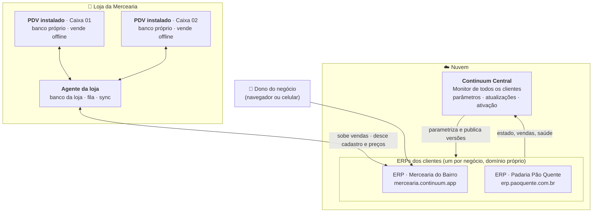
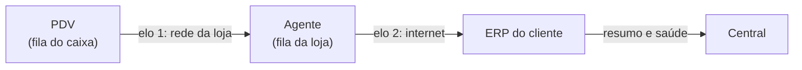

# Etapa 2 · Arquitetura do protótipo final

> Status: **✅ aprovada pelos sócios (v2, 21/11/2026)**. Nenhum código foi escrito a partir deste documento ainda.
> Cada decisão tem um "por quê", para servir também de material de apresentação.
>
> **O que mudou da v1:** o Monitor virou o **Continuum Central**, na nuvem, de onde saem os parâmetros e as
> atualizações. A Gestão virou o **ERP do cliente**, personalizado e com domínio próprio. O **PDV passou a ser
> instalado**, com banco próprio. Também entraram as opções de hospedagem e o plano para reaproveitar o código do OLD.

## 1. Em uma frase

O **Continuum Central** (na nuvem) parametriza e acompanha todos os clientes. Cada cliente tem o **seu
ERP**, com a cara e o domínio do negócio. Os **PDVs instalados** nas lojas recebem tudo do ERP do
cliente e **continuam vendendo sem internet e até sem a rede da loja**.

## 2. Os princípios (a essência que não muda)

| Princípio | O que significa na prática |
|---|---|
| **Local First** | A venda é gravada **no próprio caixa** antes de ir para qualquer rede. Sem internet, ou sem a rede da loja, o caixa continua vendendo. |
| **Nada se perde** | Toda venda vira um evento numa fila (outbox) e só sai dela quando o próximo elo confirma. Venda não se apaga; cancelamento é estorno. |
| **Monitoramento aberto** | O Central vê ao vivo o estado de cada cliente, loja e caixa: vendendo, offline, quanto falta sincronizar, qual versão está rodando. |
| **Um sistema, vários clientes** | O mesmo software vira o ERP de uma mercearia ou de uma rede, **parametrizado** para cada um, sem código sob medida. |
| **Rastreável** | Cada registro tem origem (cliente, loja, caixa), número de sequência e caminho conhecido do caixa até a nuvem. |

## 3. As peças do sistema



| Peça | Onde roda | Quem usa | O que faz | Vem do OLD? |
|---|---|---|---|---|
| **Continuum Central** | Nuvem | **Equipe Continuum** (vocês) | Monitora **todos** os clientes ao vivo; cria e parametriza o ERP de cada cliente (domínio, marca, módulos, regras); publica atualizações do sistema; ativa e desativa dispositivos | Sim: o Dashboard e o Monitor atuais |
| **ERP do cliente** | Nuvem, no domínio do cliente | **Dono e gerente** do negócio | Produtos, preços, estoque, caixas, relatórios, notas fiscais; é a fonte dos dados que os PDVs recebem | Novo (planejado no METAS) |
| **Agente da loja** | Um computador da loja | Ninguém diretamente (roda sozinho) | Junta os caixas da loja; banco e estoque da loja; sincroniza com o ERP do cliente | Sim: o LAB (banco local, outbox, Sync Engine, máquina de estados) |
| **PDV instalado** | Cada caixa | **Operador de caixa** | Venda, comprovante, operação de caixa; banco próprio para vender mesmo isolado | Sim: o PDV atual, agora instalado |

### Por que cada decisão

- **Central separado dos ERPs.** O Central é a "torre de controle" da empresa Continuum: vê todos os
  clientes, mas cada cliente só vê o próprio ERP. É ali que se decide quais módulos o cliente tem, qual
  modelo de comprovante, quais regras de estoque, e quando ele recebe uma versão nova.
- **ERP com a cara do cliente.** Cada negócio entra no **seu** endereço (`mercearia.continuum.app` ou um
  domínio próprio, como `erp.paoquente.com.br`), com logo, cores e módulos dele. Para o cliente, é o
  sistema **dele**.
- **Um ERP por cliente, mas um só programa.** Tecnicamente todos os ERPs são **o mesmo software**,
  que identifica o cliente pelo endereço acessado e carrega os parâmetros dele. **Por quê:** uma
  correção ou melhoria vale para todos de uma vez, e o custo de servidor não cresce a cada cliente.
  Um cliente grande pode ter, no futuro, uma instalação dedicada, sem mudar o código.
- **PDV instalado com banco próprio.** O caixa não depende nem da internet nem da rede da loja: se o
  cabo ou o roteador cair, ele continua vendendo. Ele recebe do agente o cadastro e os preços e devolve
  as vendas quando a conexão volta.

## 4. Dois níveis de "Local First"

O OLD provou um nível (loja ↔ nuvem). Com o PDV instalado, passam a ser **dois elos**, cada um com a
própria fila:



| O que cai | O que acontece |
|---|---|
| **Internet** | PDVs e agente seguem normalmente; a fila do agente acumula. O Central mostra a loja como **OFFLINE · vendendo**. |
| **Rede da loja** (ou o computador do agente) | Cada PDV vende sozinho; a fila **do caixa** acumula. Na volta, o caixa entrega ao agente, que entrega ao ERP. |
| **Os dois** | Mesmo assim o caixa vende. Nada se perde em nenhum elo. |

**Formato MEI (um computador só):** o PDV instalado já traz o agente embutido. É uma instalação única,
com o mesmo comportamento.

### Duas consequências que mudam regras do OLD

1. **Código da venda com o nome da loja** (decidido pelos sócios): `NOMELOJAREDUZIDO-00000-ABCD`.
   - **Nome reduzido:** definido no cadastro da loja (ERP ou Central), só letras e números, até 10
     caracteres e único dentro do cliente. Exemplo: `MERCBAIRRO`.
   - **00000:** número sequencial da venda.
   - **ABCD:** 4 caracteres de conferência tirados do identificador interno da venda, que impedem um
     código digitado errado (ou inventado) de validar outra venda.
   - ⚠️ **Ponto a resolver:** no OLD o número era da loja (o maior + 1). Com caixas isolados, o Caixa 1
     e o Caixa 2 gerariam, cada um, a venda `MERCBAIRRO-00123`. Proposta: o primeiro dígito do número
     indica o caixa (`MERCBAIRRO-10123` no Caixa 1, `MERCBAIRRO-20123` no Caixa 2). O formato pedido
     se mantém e nunca há colisão. Alternativa: uma letra do caixa depois do nome (`MERCBAIRRO-A-00123-ABCD`).
2. **Estoque com caixas isolados.** Se dois caixas sem rede venderem a última unidade do café, cada um
   acha que tem estoque. Os grandes ERPs resolvem isso com uma **regra configurável por cliente**, e
   proponho o mesmo, parametrizado no Central:
   - **Bloquear** a venda sem estoque, quando o caixa sabe o saldo (conectado ao agente);
   - **Permitir com alerta** quando o caixa está isolado: o ERP mostra "estoque negativo a conferir"
     e a loja ajusta depois. O cliente nunca deixa de vender por falta de rede.

## 5. Onde cada dado "mora"

| Dado | Nasce em | Fonte da verdade | Caminho | Conflito? |
|---|---|---|---|---|
| Venda e itens | PDV | PDV → agente → ERP | Sobe | Nenhum: venda só é criada, e o número distingue o caixa |
| Movimentação de estoque | PDV ou ERP (entrada, ajuste) | ERP | Sobe | Nenhum: o saldo é a **soma** das movimentações |
| Produto, preço, cadastro | ERP | ERP | Desce: ERP → agente → PDV | Versão: a mudança mais nova vence |
| Parâmetros do cliente (módulos, comprovante, regras) | Central | Central | Desce: Central → ERP → agente → PDV | Central vence |
| Versão do sistema | Central | Central | Desce, quando o caixa está fechado | Nenhum |
| Sessão de caixa, sangria | PDV | PDV → agente → ERP | Sobe | Nenhum: só é criada |
| Saúde ao vivo (heartbeat) | Agente e PDV | — | Sobe até o Central, a cada poucos segundos | Não se guarda histórico longo |

**Novidade em relação ao OLD:** hoje a sincronização só **sobe**. Agora ela também **desce** (preço,
cadastro, parâmetros, versões). Usa o mesmo princípio ao contrário: quem recebe guarda "até onde já
recebeu" e pede só o que é novo.

## 6. Os fluxos principais

### 6.1 Venda com a rede caindo

```mermaid
sequenceDiagram
  participant P as PDV (caixa)
  participant A as Agente da loja
  participant E as ERP do cliente
  participant C as Central
  P->>P: grava venda + estoque + evento na fila do caixa (mesma transação)
  P-->>P: imprime comprovante com código MERCBAIRRO-10123-ABCD
  P->>A: entrega a fila do caixa
  A->>A: grava na fila da loja
  Note over A,E: internet cai
  A--xE: envio falha (3 vezes → OFFLINE)
  A->>A: fila da loja acumula; os caixas seguem vendendo
  C-->>C: "Mercearia · Loja 1 · OFFLINE · vendendo"
  Note over A,E: internet volta
  A->>E: envia a fila em ordem, em lotes
  E->>E: valida evento a evento, sem duplicar
  E-->>A: confirmado até o evento nº 123
  E-->>C: Loja 1 · SAUDÁVEL · fila zerada
```

### 6.2 Preço alterado no ERP

1. O dono muda o preço do café no **ERP** dele (de qualquer lugar).
2. O ERP grava a nova versão do produto.
3. O **agente** recebe a mudança na próxima sincronização e repassa aos **PDVs**.
4. Um caixa isolado continua com o preço antigo até a rede voltar; a venda registra o preço praticado,
   então nada fica inconsistente.

### 6.3 Atualização do sistema (a partir do Central)

1. A equipe Continuum publica a versão nova no **Central** e escolhe quem recebe primeiro (por exemplo,
   um cliente piloto).
2. Agentes e PDVs baixam a versão em segundo plano.
3. A instalação só acontece **com o caixa fechado**, nunca no meio de uma venda.
4. O Central mostra quais lojas já estão na versão nova e quais falharam.

### 6.4 Monitoramento aberto

Agente e PDVs enviam um **heartbeat** (sinal de vida) a cada poucos segundos: estado, tamanho das filas,
caixas abertos, última venda, versão. O ERP do cliente mostra isso ao dono; o **Central** mostra o
consolidado de **todos os clientes** em tempo real (WebSocket). Se o heartbeat para de chegar, a loja
aparece como **sem sinal**, com o tempo desde o último contato.

## 7. Vários clientes, cada um com o seu ERP

```
Continuum Central
 └─ Cliente (empresa)   CNPJ ou CPF, nome, segmento, plano, domínio, marca
     ├─ Parâmetros      módulos ligados, modelo de comprovante, regra de estoque, versão
     ├─ Usuários        dono, gerente, operador de caixa, contador
     └─ Loja            endereço, dados impressos no comprovante
         ├─ Agente      dispositivo ativado
         └─ Caixa (PDV) dispositivo ativado, com numeração própria
```

- **Isolamento:** cada registro carrega o identificador do cliente. Um cliente **nunca** vê dados de
  outro, e a regra é aplicada no banco, não só na tela.
- **Personalização = parâmetros, não código.** O Central oferece **modelos por segmento**: mercearia
  (venda por unidade e por quilo), padaria (produção), loja de roupa (tamanho e cor). O cliente parte
  de um modelo e ajusta. Com 100 clientes, continua sendo **um** sistema para manter.

## 8. Segurança

| Camada | Como |
|---|---|
| Pessoas | Login com perfil (equipe Continuum no Central; dono, gerente, operador, contador no ERP); ações sensíveis pedem supervisor |
| Dispositivos | Cada agente e PDV é **ativado** por um código gerado no ERP e tem credencial própria; um caixa roubado é desativado na hora |
| Transporte | Conexão criptografada (HTTPS) em todos os elos que passam pela internet |
| Dados | Isolamento por cliente no banco; venda e estoque não se apagam; backups diários |
| Auditoria | Quem fez o quê e quando, no Central e em cada ERP, sem possibilidade de edição |
| LGPD | CPF do cliente final só quando ele pede na nota, mascarado nos relatórios |

## 9. Stack (a mesma do OLD, organizada para crescer)

| Camada | Tecnologia | Por quê |
|---|---|---|
| Linguagem | **TypeScript** em tudo | Já é a do OLD; os tipos evitam erros e ajudam a IA a escrever código correto |
| Nuvem (Central e ERPs) e agente | **Node.js** | Já usado no OLD |
| Banco da nuvem | **PostgreSQL** | Já usado no OLD; aguenta muitos clientes no mesmo banco, isolados |
| Banco do agente e do PDV | **SQLite** | Já usado no OLD; um arquivo, sem instalação, funciona offline |
| PDV instalado | **Electron** (proposta) | Leva o Node e o SQLite **dentro** do programa, então o PDV reaproveita o mesmo código do agente. Tem impressão e atualização automática prontas. A alternativa mais leve, Tauri, exigiria Rust, uma linguagem nova no projeto. |
| Front-end (Central, ERP, telas do PDV) | **Framework a decidir na Etapa 3** (proposta: React) | Componentes e identidade visual compartilhados entre as três interfaces |
| Testes | Testes automáticos em cada regra + simulador de falhas | Já é a cultura do OLD (Kryptonita, cenários de queda) |

### Organização do código (monorepo)

```
continuum/
├─ pacotes/
│  ├─ dominio/      Regras de negócio puras: venda, estoque, caixa, CPF, CNPJ, EAN (iguais em todo lugar)
│  ├─ contratos/    Formato dos eventos e das APIs (o "idioma" entre PDV, agente, ERP e Central)
│  ├─ sync/         Fila (outbox), Sync Engine e máquina de estados, usados nos dois elos
│  ├─ agente/       Programa da loja
│  ├─ pdv/          PDV instalado (Electron): banco do caixa + telas
│  ├─ nuvem/        Servidor: ERP de cada cliente (por domínio) + Continuum Central
│  └─ interface/    Componentes visuais e identidade do Continuum, para Central, ERP e PDV
├─ docs/            Arquitetura, casos de uso, UML, banco (estas etapas)
├─ site/            Landing page
└─ OLD/             Projeto anterior, de referência
```

**Por que `dominio` e `sync` são os pacotes mais importantes:** a regra "venda não se apaga" e o
mecanismo "nada sai da fila sem confirmação" precisam ser **idênticos** no caixa, no agente e na
nuvem. Escritos uma vez e usados por todos, nunca divergem.

## 10. Hospedagem: opções para o custo inicial (decisão 3)

Valores **aproximados**, de referência; confirmar o preço na hora de contratar, porque mudam com
frequência e com o câmbio.

| Opção | Como é | Custo inicial aproximado | Prós | Contras |
|---|---|---|---|---|
| **A · Camadas gratuitas** | App em Render, Railway ou Fly.io + PostgreSQL gerenciado gratuito (Neon ou Supabase) | **R$ 0 a 50/mês** | Começa sem custo; backup e banco cuidados pelo provedor | Limites de tamanho e de "sono" do servidor no plano grátis; servidores fora do Brasil |
| **B · Um VPS** | Um servidor virtual (Hostinger, Contabo, Hetzner, DigitalOcean) rodando tudo: Node + PostgreSQL | **R$ 30 a 80/mês** | Custo fixo e previsível; controle total; há opção com servidor no Brasil | Vocês cuidam de backup, atualizações e segurança do servidor |
| **C · Nuvem grande** | AWS, Google Cloud ou Azure, região São Paulo, com banco gerenciado | **R$ 200 a 500+/mês** | Escala sem limite; dados no Brasil (LGPD); serviços prontos | Caro para começar; mais complexo. Programas para startups dão créditos gratuitos |

**Recomendação:** começar com a **opção A** durante o desenvolvimento e o piloto (custo perto de zero),
e migrar para a **opção B com servidor no Brasil** quando houver os primeiros clientes pagantes. A
arquitetura não depende do provedor, então a troca é uma mudança de configuração, não de código. Vale
inscrever o projeto nos programas de créditos para startups (AWS Activate, Google for Startups,
Microsoft for Startups) antes de pensar na opção C.

**Domínios dos clientes:** um domínio do Continuum com subdomínios (`cliente.continuum.app`) custa
cerca de R$ 40 a 80/ano. Para clientes com domínio próprio, o Cloudflare permite apontar o domínio do
cliente para o Continuum com certificado HTTPS automático, gratuito para os primeiros clientes.

## 11. Reaproveitar o código do OLD (decisão 4)

O OLD tem só o backend **compilado** (54 arquivos, cerca de 4.900 linhas de JavaScript), sem os mapas
que guardariam o TypeScript original. Mas o código compilado é **legível e mantém os comentários
originais**, inclusive as referências aos ADRs. Então a lógica pode ser reconstruída em TypeScript:

| Do OLD | Vira | Como |
|---|---|---|
| Outbox, Sync Engine, máquina de estados, backoff | `sync` | Reconstrução arquivo a arquivo, devolvendo os tipos |
| Regras de venda, estoque, produto (LabVendas) | `dominio` | Idem, com os testes reescritos junto |
| cloud-api (recebimento e validação de eventos) | `nuvem` | Base do recebimento, agora multi-cliente e com descida |
| Kryptonita (simulador de falhas) | Ferramenta de testes | Mantida para provar que nada se perde |
| PDV, código da venda, utilitários (CPF, CNPJ, EAN) | `pdv` e `dominio` | Já são nossos e legíveis |
| Dashboard e telas do Monitor | `interface` e Central | Base visual da nova interface |

**Proposta:** fazer a reconstrução **junto com a construção de cada pacote**, e não como uma etapa
solta. Cada arquivo do OLD é lido, explicado a você e reescrito em TypeScript com os testes, antes de
seguir. Vira também uma forma de você conhecer o coração do projeto por dentro.

## 12. Decisões

| # | Decisão | Situação |
|---|---|---|
| 1 | PDV instalado, operando offline e buscando os dados do agente | ✅ Decidido pelos sócios |
| 2 | Comprovante não fiscal agora, NFC-e depois | ✅ Decidido pelos sócios (confirmar obrigação por estado com contador) |
| 3 | Hospedagem | 🟡 Proposta: opção A no desenvolvimento, opção B (Brasil) com os primeiros clientes |
| 4 | Código-fonte original | 🟡 Proposta: reconstruir a partir do OLD, pacote a pacote |
| 5 | Estoque com caixas isolados | ✅ Decidido pelos sócios: regra configurável por cliente ("bloquear" ou "permitir com alerta") |
| 7 | Código da venda | ✅ Decidido: `NOMELOJAREDUZIDO-00000-ABCD` · 🟡 falta definir como distinguir os caixas (seção 4) |
| 6 | Tecnologia do PDV instalado | 🟡 **Nova:** proposta Electron (mesma linguagem do resto) |

## 13. Glossário (para apresentações)

| Termo | Explicação simples |
|---|---|
| **Continuum Central** | A torre de controle da empresa Continuum: vê e parametriza todos os clientes |
| **ERP do cliente** | O sistema de gestão de cada negócio, com a cara e o endereço dele |
| **Agente da loja** | O programa que junta os caixas de uma loja e conversa com o ERP |
| **PDV instalado** | O programa do caixa, que vende mesmo sem internet e sem rede |
| **Local First** | Grava primeiro onde a venda acontece; a rede vem depois |
| **Outbox (fila)** | Lista de tudo que ainda precisa seguir adiante; nada sai dela sem confirmação |
| **Sync Engine** | O "carteiro" que leva a fila até o próximo elo, em ordem |
| **Heartbeat** | Sinal de vida enviado a cada poucos segundos |
| **Multi-cliente (tenant)** | Vários clientes no mesmo sistema, cada um vendo só os seus dados |
| **Parâmetros** | As configurações que deixam o sistema com a cara de cada negócio |
| **Electron** | Tecnologia para criar programas instalados usando a mesma linguagem da web |
| **Monorepo** | Um repositório só com todas as partes do sistema |
