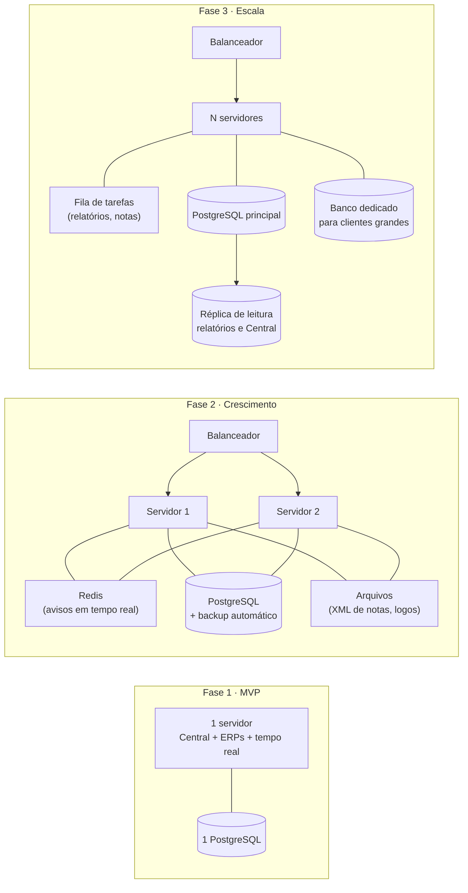
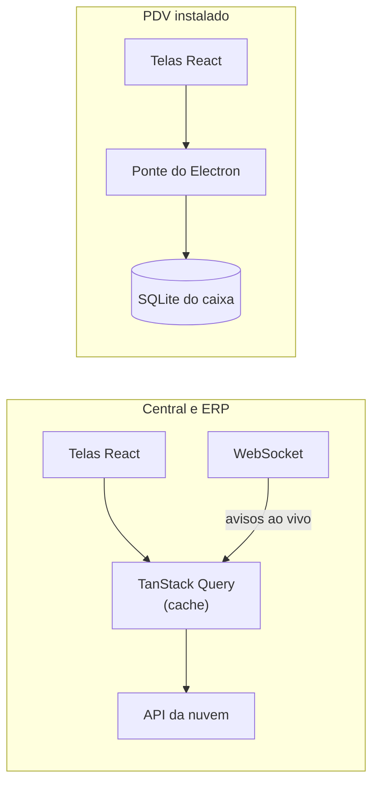

# Etapa 3 · Escalabilidade e front-end

> Status: **✅ aprovada pelos sócios (decisões 1 a 7, 21/11/2026)**. Nenhum código foi escrito a partir deste documento ainda.
> Parte da arquitetura aprovada em `01-arquitetura.md` (Central, ERP do cliente, agente, PDV instalado).

Este documento responde a duas perguntas:

1. **Escalabilidade:** o que acontece quando passarmos de 1 para 100 e depois para 5.000 clientes, e o
   que precisa estar pronto em cada fase sem gastar antes da hora.
2. **Front-end:** com que framework construir as telas, mantendo a cara do Continuum e funcionando
   bem no celular, no tablet, no caixa e no telão.

---

# Parte 1 · Escalabilidade

## 1.1 Primeiro, os números (para não superdimensionar)

Uma estimativa simples de carga, a partir de um caixa de mercearia:

| Medida | Valor estimado |
|---|---|
| Vendas por caixa por dia | ~300 |
| Eventos por venda (venda + baixa de estoque por item) | ~4 |
| **Eventos por caixa por dia** | **~1.200** |
| Heartbeat (sinal de vida) | 1 a cada 15 s por dispositivo |

| Fase | Clientes | Caixas | Eventos por dia | Média por segundo | Pico (10× a média) |
|---|---|---|---|---|---|
| **MVP / piloto** | até 10 | até 20 | 24 mil | < 1 | ~3 |
| **Crescimento** | até 300 | até 1.000 | 1,2 milhão | ~14 | ~140 |
| **Escala** | até 5.000 | até 15.000 | 18 milhões | ~210 | ~2.100 |

**O que isso quer dizer:** até a fase de crescimento, **um único servidor Node com um PostgreSQL**
aguenta com folga. No OLD, o cenário de 100.000 vendas já rodou num computador comum. Ou seja, não
precisamos de infraestrutura cara para começar; precisamos de uma arquitetura que **permita** crescer
sem reescrever. É isso que este plano garante.

## 1.2 Como cada parte cresce



| Parte | Fase 1 · MVP | Fase 2 · Crescimento | Fase 3 · Escala |
|---|---|---|---|
| **Servidor (API)** | 1 instância | 2+ instâncias atrás de um balanceador | N instâncias, que sobem e descem com a demanda |
| **Tempo real (Monitor)** | Na própria instância | **Redis** repassa os avisos entre as instâncias | Idem, com mais capacidade |
| **Banco** | 1 PostgreSQL | + backup automático e restauração testada | + **réplica de leitura** para relatórios; tabelas de eventos **particionadas por mês** |
| **Clientes grandes** | — | — | Podem ganhar **banco dedicado**, sem mudar o código |
| **Arquivos** (XML, logos) | Disco do servidor | Armazenamento de objetos (barato, tipo S3) | Idem |
| **Tarefas pesadas** (relatórios, ler notas) | Na hora | Na hora | **Fila de tarefas** em segundo plano |
| **Observação do sistema** | Logs | Logs + métricas + alertas no Central | Idem, com painéis por cliente |

### Por que dá para crescer assim sem reescrever

1. **Servidor sem memória própria (stateless).** Nenhuma informação importante fica guardada dentro do
   servidor; tudo está no banco. Então colocar um segundo servidor é só ligar outro igual.
2. **Eventos imutáveis e em ordem.** Como no OLD, cada evento tem número de sequência e nunca muda.
   Isso permite reenviar, dividir em lotes e processar em paralelo sem perder a ordem por loja.
3. **Isolamento por cliente desde o primeiro dia.** Toda tabela carrega o identificador do cliente,
   com bloqueio no próprio banco (Row Level Security do PostgreSQL). Mover um cliente grande para um
   banco só dele vira uma operação, não um projeto.
4. **O peso fica na loja.** A venda acontece no PDV e no agente; a nuvem só **recebe e consolida**.
   Mil lojas vendendo não significam mil vezes mais trabalho em tempo real na nuvem.

## 1.3 Cuidados que valem desde o MVP (custam pouco agora, muito depois)

| Cuidado | Por quê |
|---|---|
| Identificador do cliente em **toda** tabela da nuvem | Adicionar depois exige migrar todos os dados |
| Identificadores únicos gerados na origem (UUID v7, como no OLD) | Loja e nuvem criam registros sem perguntar um ao outro |
| Lotes no envio e espera progressiva quando falha (backoff) | Já existe no OLD; evita derrubar a nuvem quando mil lojas voltam ao mesmo tempo |
| Heartbeat leve e agregado | 15.000 dispositivos a cada 15 s são só ~1.000 avisos por segundo, e pequenos |
| Versionamento dos contratos (formato dos eventos) | PDVs desatualizados continuam conversando com a nuvem nova |
| Backup e **teste de restauração** | Backup que nunca foi restaurado não é backup |

---

# Parte 2 · Front-end

## 2.1 Onde as telas vão rodar

| Interface | Quem usa | Onde | Tema |
|---|---|---|---|
| **Central** | Equipe Continuum | Computador, celular e **telão** (monitoramento) | Escuro, como o Dashboard atual |
| **ERP do cliente** | Dono e gerente | Computador, **celular** e tablet | Claro, como o material de apresentação, com a **marca do cliente** |
| **PDV instalado** | Operador de caixa | Computador do caixa, muitas vezes com **tela de toque** | Escuro, como o PDV atual |

As três interfaces compartilham **os mesmos componentes**: um "Cartão" ou uma "Faixa de estado" são
iguais no Central, no ERP e no PDV. Isso é o que mantém a cara do Continuum.

## 2.2 Qual framework

| Opção | A favor | Contra |
|---|---|---|
| **React** (proposta) | O mais usado do mundo; enorme quantidade de material e bibliotecas; é o que a IA escreve com mais segurança; funciona dentro do Electron (PDV) | Mais escolhas a fazer (por isso este documento as faz) |
| Vue | Simples de aprender | Ecossistema menor |
| Svelte | Leve e rápido | Menos bibliotecas e menos exemplos |
| Angular | Completo, muito estruturado | Pesado e verboso para um projeto deste porte |

**Proposta: React + TypeScript + Vite.** O Vite é a ferramenta que monta o projeto: deixa o
desenvolvimento rápido e gera arquivos finais **sem depender de nada da internet**, o que preserva a
regra do OLD (ADR 013: o painel não carrega nada de fora).

### As peças em volta do React

| Necessidade | Escolha proposta | Por quê |
|---|---|---|
| Navegação entre telas | React Router | Padrão do mercado |
| Dados da nuvem e atualização ao vivo | TanStack Query + WebSocket | Guarda em cache, atualiza sozinho e mostra "carregando" e "erro" de forma padronizada |
| Formulários e validação | React Hook Form + **Zod** | As regras de validação (CPF, preço, quantidade) são escritas **uma vez**, no pacote `contratos`, e usadas pela tela **e** pelo servidor |
| Estilo | **CSS com tokens de design** (variáveis) + CSS Modules | Mantém exatamente as cores e medidas do Continuum, sem depender de um kit visual de terceiros que daria "cara de template" |
| Ícones | Lucide (empacotado no projeto) | Mesmo estilo de traço dos ícones atuais, sem baixar nada da internet |
| Gráficos | Componentes próprios em SVG (como no Dashboard atual) | Leves e com a identidade do Continuum; uma biblioteca só se surgirem gráficos complexos |
| Testes de tela | Vitest + Testing Library | Mesma ferramenta de testes do backend do OLD |

## 2.3 O design system do Continuum

O pacote `interface` guarda a identidade visual num lugar só:

```
interface/
├─ tokens/        cores, espaçamentos, raios, tipografia, sombras (tema claro e escuro)
├─ componentes/   Botão, Cartão, Chip, FaixaDeEstado, KPI, Tabela, Modal, Aviso, Gráfico, Cupom...
├─ layouts/       Lateral + conteúdo (Central e ERP), Caixa (PDV), Telão (monitoramento)
└─ marca/         logo, ícone, regras de uso da marca
```

### Os tokens (a "cara" em números)

Extraídos do que já existe: o Dashboard e o PDV para o tema escuro, o PDF e a landing para o claro.

| Token | Tema escuro (Central, PDV) | Tema claro (ERP, site) |
|---|---|---|
| Fundo | `#050a17` | `#f5f6fb` |
| Cartão | `#0a1328` | `#ffffff` |
| Borda | `#1a2a4a` | `#e2e5f3` |
| Primária | `#2563eb` → `#38bdf8` (gradiente) | `#3d4bf0` (azul royal) |
| Texto | `#e8eef9` | `#2a2f45` |
| Sucesso / Atenção / Erro | `#34d399` / `#fbbf24` / `#f87171` | mesmos tons, ajustados para contraste no claro |
| Estados do sistema | SAUDÁVEL verde · DEGRADADO âmbar · OFFLINE vermelho · SINCRONIZANDO azul | idem |

**Marca do cliente no ERP:** o Central permite trocar o **logo** e a **cor primária** de cada cliente.
O sistema confere o **contraste** automaticamente: se a cor escolhida deixar o texto ilegível, ele
ajusta o tom. A identidade do cliente aparece, mas a estrutura e a legibilidade continuam as do
Continuum.

## 2.4 Melhorias visuais em relação ao OLD

| Hoje (OLD) | No protótipo final |
|---|---|
| Medidas definidas tela a tela | **Escala única** de espaçamento e tipografia: tudo alinhado entre as telas |
| Telas pensadas para 1366×768 | Responsivas de verdade, do celular ao telão (seção 2.5) |
| Carregamento sem aviso | Esqueletos de carregamento, telas de "vazio" e de "erro" padronizadas |
| Só tema escuro no painel | Tema claro e escuro, com troca pelo usuário |
| Acessibilidade parcial | Contraste mínimo AA, navegação por teclado, foco visível, respeito a "reduzir animações" |
| Ícones desenhados à mão no HTML | Biblioteca única de ícones, com o mesmo traço |
| Gráficos simples | Gráficos com dica ao passar o mouse, legenda e leitura acessível |

## 2.5 Responsividade

| Faixa | Largura | Exemplo | Como a tela se organiza |
|---|---|---|---|
| **Celular** | até 600 px | Dono olhando as vendas no ônibus | Menu vira **barra inferior**; tabelas viram **cartões**; KPIs em uma coluna |
| **Tablet** | 600 a 1024 px | Gerente no estoque | Menu recolhido em ícones; duas colunas |
| **Computador** | 1024 a 1600 px | Escritório e caixa | Lateral completa; layout em grade, como hoje |
| **Telão** | acima de 1600 px | TV de monitoramento no Central | **Modo telão**: letras maiores, só o essencial, atualização ao vivo, sem precisar de mouse |

**Regras especiais do PDV:**
- Pensado primeiro para **1366×768** (o caixa mais comum) e para **tela de toque**: botões com no
  mínimo 44 px, nada que dependa de passar o mouse.
- **Todo** o caixa funciona pelo teclado e pelo leitor de código de barras (F2 busca, F9 finaliza,
  Esc cancela), como nos PDVs de mercado.
- **Modo quiosque:** tela cheia, sem barra do navegador, sem como sair sem senha.

## 2.6 Como as telas conversam com os dados



**Por que o PDV fala com o banco local, e não com a internet:** é o que garante a venda sem rede. A
tela do caixa nunca espera a nuvem; ela grava no banco do próprio caixa, e a fila cuida do resto.

---

## Decisões para aprovar

| # | Decisão | Proposta |
|---|---|---|
| 1 | Metas de capacidade por fase | MVP até 20 caixas; crescimento até 1.000; escala até 15.000 |
| 2 | Infraestrutura | Começar com 1 servidor e 1 banco; Redis, réplicas e fila só quando os números pedirem |
| 3 | Isolamento por cliente | Identificador do cliente em toda tabela + Row Level Security desde o MVP |
| 4 | Framework | React + TypeScript + Vite |
| 5 | Estilo | Design system próprio com tokens (sem kit visual de terceiros) |
| 6 | Temas | Escuro para Central e PDV; claro para o ERP; marca do cliente no ERP com controle de contraste |
| 7 | Responsividade | Celular, tablet, computador e modo telão; PDV para 1366×768 e toque |

## Glossário

| Termo | Explicação simples |
|---|---|
| **Escalabilidade** | A capacidade de atender mais clientes sem reescrever o sistema |
| **Stateless** | Servidor que não guarda nada importante dentro de si; dá para ligar vários iguais |
| **Balanceador** | Distribui os pedidos entre vários servidores |
| **Redis** | Memória rápida compartilhada, usada para repassar avisos ao vivo entre servidores |
| **Réplica de leitura** | Cópia do banco só para consultas pesadas, sem atrasar as vendas |
| **Particionar** | Dividir uma tabela enorme em pedaços (por mês), para continuar rápida |
| **Row Level Security** | Regra no próprio banco que impede um cliente de ver linhas de outro |
| **Framework** | Base pronta para construir telas, em vez de começar do zero |
| **Design system** | O "manual vivo" da identidade visual: cores, medidas e componentes reutilizáveis |
| **Token de design** | Uma decisão visual com nome, como `cor-primaria`, usada em todas as telas |
| **Responsivo** | Tela que se reorganiza conforme o tamanho do aparelho |
