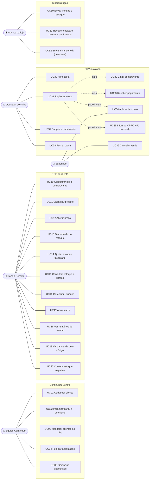
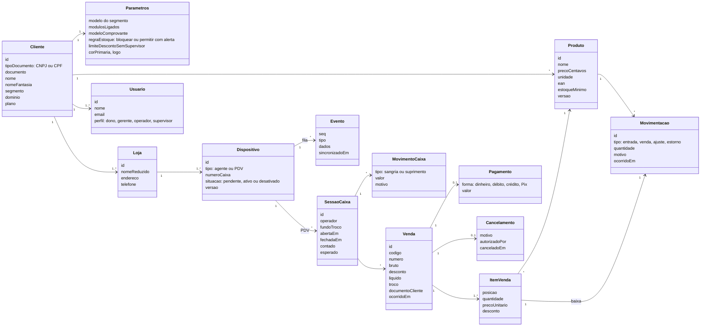
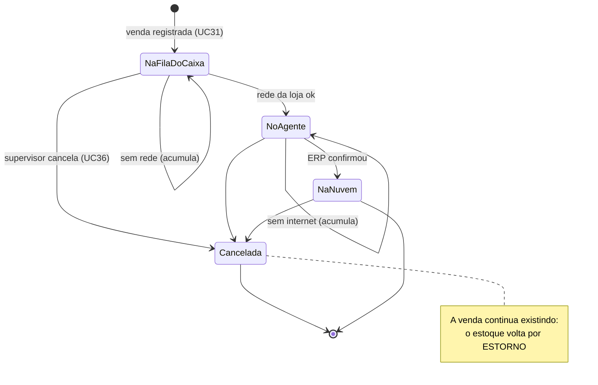
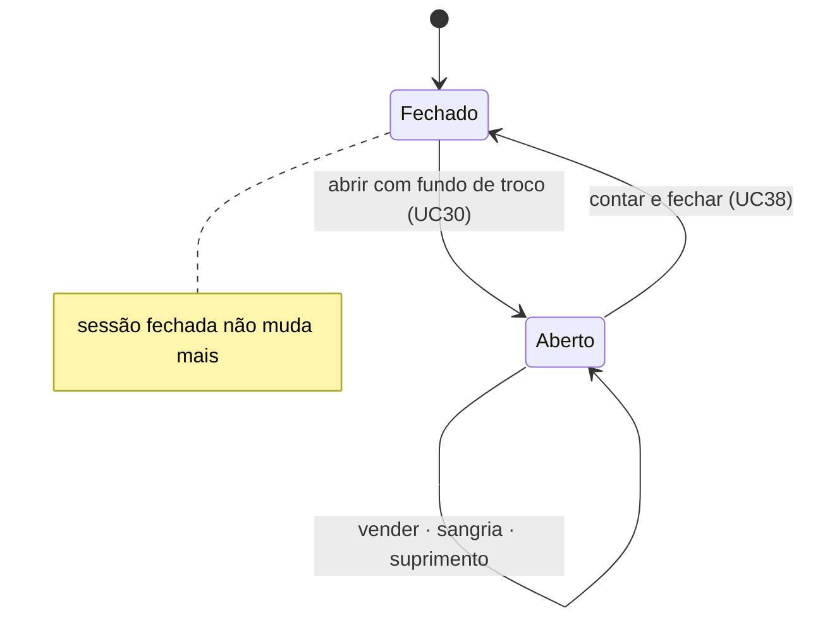
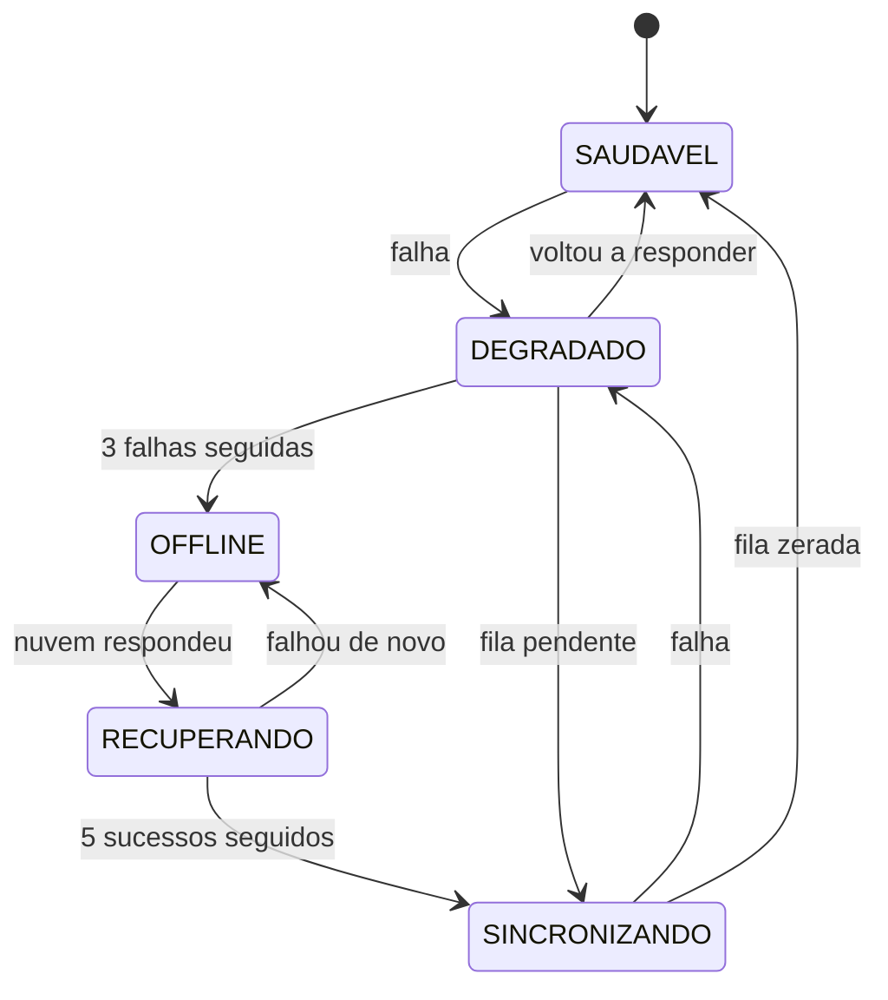
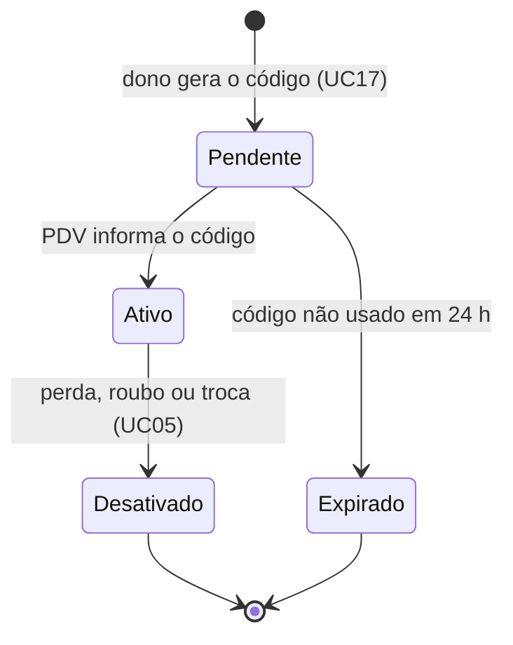
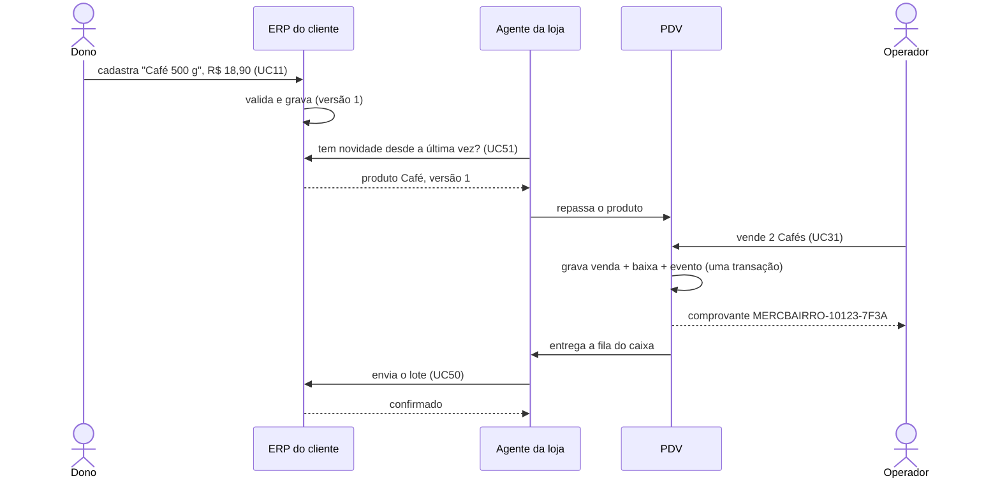
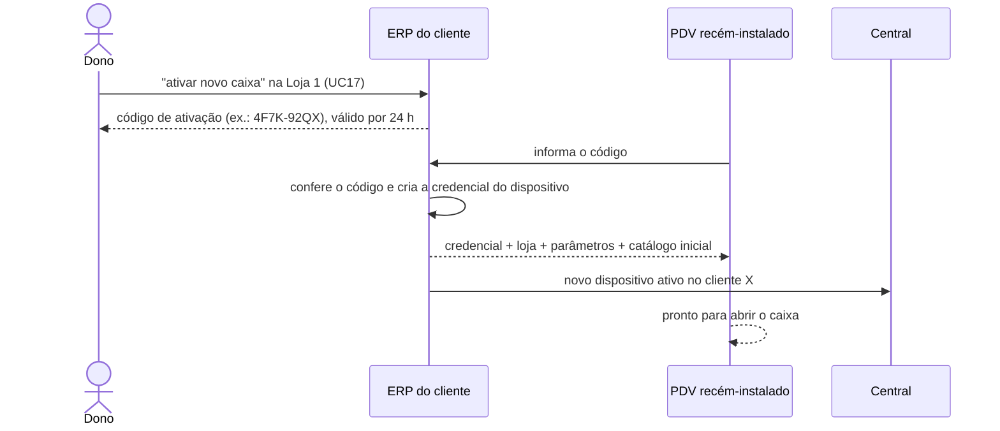
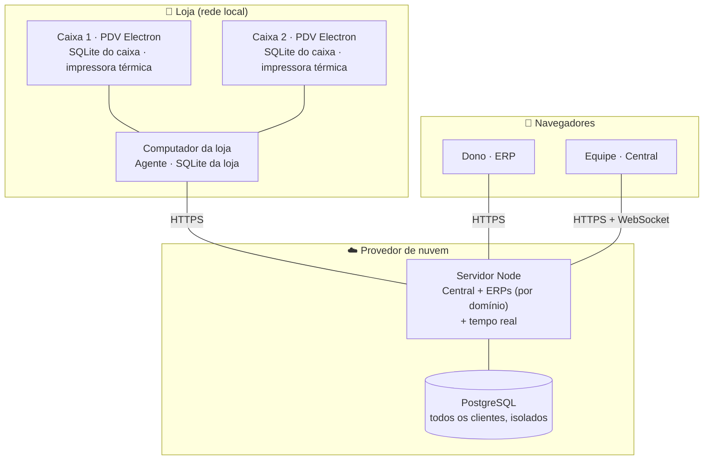

# Etapa 4 · Casos de uso e UML

> Status: **✅ aprovada pelos sócios (decisões 1 a 6, 21/11/2026)**. Nenhum código foi escrito a partir deste documento ainda.
> Parte da arquitetura (`01-arquitetura.md`) e do front-end (`02-escalabilidade-e-frontend.md`), ambos aprovados.
> O **modelo do banco de dados** vem no próximo documento (`04-banco-de-dados.md`), depois desta aprovação.

## Como ler este documento

- **Caso de uso:** uma coisa que alguém quer fazer no sistema, contada passo a passo ("o operador
  registra uma venda"). Serve para todos concordarem sobre **o que** o sistema faz, antes de pensar em
  **como**.
- **UML:** uma linguagem de desenhos padrão para software. Usamos cinco tipos: casos de uso (quem faz o
  quê), classes (quais "coisas" existem e como se ligam), estados (por quais situações uma coisa passa),
  sequência (a conversa entre as peças, na ordem) e implantação (onde cada peça roda).
- **Prioridade:** **P0** = entra no MVP; **P1** = logo depois do MVP; **P2** = futuro.

---

## 1. Atores (quem usa o sistema)

| Ator | Quem é | Onde atua |
|---|---|---|
| **Equipe Continuum** | Vocês, os operadores da plataforma | Central |
| **Dono** | O dono do negócio (MEI ou microempresa) | ERP do cliente |
| **Gerente** | Quem cuida da loja no dia a dia (no MEI, é o próprio dono) | ERP do cliente |
| **Operador de caixa** | Quem vende no balcão | PDV |
| **Supervisor** | Quem autoriza exceções no caixa (desconto alto, cancelamento) | PDV |
| **Cliente final** | Quem compra; recebe o comprovante | (fora do sistema) |
| **Agente da loja** | Programa que sincroniza a loja (ator "sistema") | Loja |
| **Relógio** | Tarefas automáticas no tempo: heartbeat, nova tentativa de envio | Todas as peças |

## 2. Mapa dos casos de uso



## 3. Lista completa com prioridade

| UC | Nome | Ator | Prioridade | Observação |
|---|---|---|---|---|
| UC01 | Cadastrar cliente | Equipe Continuum | **P0** | Empresa com CNPJ **ou** CPF, segmento, domínio |
| UC02 | Parametrizar ERP do cliente | Equipe Continuum | **P0** | No MVP: modelo do segmento, comprovante, regra de estoque |
| UC03 | Monitorar clientes ao vivo | Equipe Continuum | **P0** | A essência do Continuum |
| UC04 | Publicar atualização | Equipe Continuum | P1 | No MVP, a atualização é manual |
| UC05 | Gerenciar dispositivos | Equipe Continuum | P1 | Desativar caixa roubado |
| UC10 | Configurar loja e comprovante | Dono | **P0** | Nome reduzido, endereço, dados impressos |
| UC11 | Cadastrar produto | Dono | **P0** | Nome, preço, código de barras, unidade |
| UC12 | Alterar preço | Dono | **P0** | Com controle de versão |
| UC13 | Dar entrada no estoque | Dono | **P0** | Manual no MVP; por XML de NF-e no P2 |
| UC14 | Ajustar estoque (inventário) | Dono | **P0** | Sempre com motivo |
| UC15 | Consultar estoque e kardex | Dono | **P0** | Saldo e histórico de cada produto |
| UC16 | Gerenciar usuários | Dono | P1 | No MVP: dono + operadores |
| UC17 | Ativar caixa | Dono | **P0** | Gera o código de ativação do PDV |
| UC18 | Ver relatórios de venda | Dono | **P0** (básico) | Vendas do dia, por forma de pagamento, mais vendidos |
| UC19 | Validar venda pelo código | Dono | **P0** | Confere se um comprovante é verdadeiro |
| UC20 | Conferir estoque negativo | Dono | P1 | Alertas de caixas que venderam isolados |
| UC30 | Abrir caixa | Operador | **P0** | Com fundo de troco |
| UC31 | Registrar venda | Operador | **P0** | O coração do PDV |
| UC32 | Emitir comprovante | Operador | **P0** | Impressão com os dados do comércio |
| UC33 | Receber pagamento | Operador | **P0** | Dinheiro, débito, crédito, Pix; misto no P1 |
| UC34 | Aplicar desconto | Supervisor | P1 | PIN acima de 10% |
| UC35 | Informar CPF/CNPJ na venda | Operador | **P0** | Opcional, a pedido do cliente |
| UC36 | Cancelar venda | Supervisor | P1 | Estorno: o estoque volta, a venda continua registrada |
| UC37 | Sangria e suprimento | Operador | P1 | |
| UC38 | Fechar caixa | Operador | **P0** | Conferência do dinheiro e relatório |
| UC50 | Enviar vendas e estoque | Agente | **P0** | Do OLD: fila, lotes, validação |
| UC51 | Receber cadastro, preços e parâmetros | Agente | **P0** | Novo: sincronização de descida |
| UC52 | Enviar sinal de vida | Agente e PDV | **P0** | Alimenta o Monitor |
| — | Entrada por XML da NF-e, lotes e validade | Dono | P2 | Do METAS |
| — | Emissão fiscal (NFC-e) | Operador | P2 | Decisão 2 da arquitetura |

**O MVP em uma frase:** a Equipe Continuum cadastra o cliente; o dono configura a loja, cadastra os
produtos e ativa o caixa; o operador abre o caixa, vende, imprime o comprovante e fecha o caixa; tudo
sincroniza e aparece ao vivo no Central.

---

## 4. Casos de uso detalhados (os do MVP que mais importam)

### UC31 · Registrar venda

| | |
|---|---|
| **Ator** | Operador de caixa |
| **Pré-condições** | PDV ativado (UC17); caixa aberto (UC30); produtos recebidos do ERP (UC51) |
| **Pós-condição** | Venda, itens, baixa de estoque e evento na fila gravados **juntos** no banco do caixa; comprovante emitido |

**Fluxo principal**
1. O operador adiciona produtos pela busca, pelo código ou pelo leitor de código de barras; pode
   multiplicar a quantidade (`3*` + código).
2. O PDV mostra cada item com preço do cadastro, subtotal e o total da venda.
3. (Opcional) O operador informa o CPF ou CNPJ do cliente (UC35).
4. O operador finaliza (F9) e informa o pagamento (UC33).
5. O PDV grava, numa **única transação**: a venda, os itens, a baixa de estoque de cada item e o evento
   na fila do caixa.
6. O PDV gera o código da venda (`MERCBAIRRO-10123-ABCD`) e emite o comprovante (UC32).
7. O PDV mostra a tela "Venda finalizada" com código, total, pagamento e troco.
8. Em segundo plano, a fila segue para o agente e depois para o ERP (UC50).

**Fluxos alternativos**
- **3a. Documento inválido:** o PDV avisa que o dígito verificador não confere e não deixa seguir com ele.
- **5a. Sem estoque, caixa conectado ao agente:** se a regra do cliente for "bloquear", a venda é
  recusada inteira e nada é gravado.
- **5b. Sem estoque, caixa isolado:** com a regra "permitir com alerta", a venda é gravada e marcada
  para conferência; o ERP mostra o alerta depois (UC20).
- **5c. Sem rede ou sem internet:** nada muda para o operador. A venda é gravada no caixa e a fila
  acumula (essência Local First).
- **4a. Pagamento incompleto:** o PDV mostra quanto falta e não grava.
- **Clique duplo / nova tentativa:** a venda leva uma chave única; repetir devolve **a mesma venda**,
  nunca grava duas.

**Regras de negócio**
- RN01 O preço vem do cadastro, nunca da tela.
- RN02 Venda não é editada nem apagada; correção é cancelamento por estorno (UC36).
- RN03 O saldo do estoque é a soma das movimentações (nunca um número digitado).
- RN04 O código da venda tem nome reduzido da loja, número com o caixa e 4 caracteres de conferência.
- RN05 Desconto acima de 10% exige o PIN do supervisor (UC34, P1).

### UC32 · Emitir comprovante

| | |
|---|---|
| **Ator** | Operador de caixa (automático ao finalizar a venda) |
| **Pré-condição** | Venda gravada (UC31) |
| **Pós-condição** | Comprovante impresso ou exibido; pode ser reimpresso a qualquer momento |

**O que o comprovante contém** (o modelo vem dos parâmetros do cliente, UC02 e UC10):

```
           MERCEARIA DO BAIRRO                ← nome fantasia
   CNPJ 12.345.678/0001-90  (ou CPF do MEI)   ← documento do comércio
   Rua Exemplo, 100 · Centro · (11) 9999-0000 ← endereço e telefone
   COMPROVANTE DE VENDA · NÃO É DOCUMENTO FISCAL
   ------------------------------------------
   Venda MERCBAIRRO-10123-7F3A   21/11 11:36  ← código e data/hora
   Caixa 01 · Operador: Ana                   ← rastreabilidade
   ------------------------------------------
   2 x Café 500 g          18,90     37,80
   1 x Arroz 5 kg          27,90     27,90
   ------------------------------------------
   TOTAL                            R$ 65,70
   Dinheiro                         R$ 70,00
   Troco                            R$  4,30
   CPF do cliente: ***.456.789-**              ← só se o cliente pediu
   ------------------------------------------
   Obrigado pela preferência!                 ← rodapé configurável
```

**Regras:** a frase "NÃO É DOCUMENTO FISCAL" é obrigatória enquanto não houver NFC-e; o documento do
cliente sai mascarado (LGPD); impressoras térmicas de 58 mm e 80 mm são suportadas; sem impressora, o
comprovante aparece na tela e pode ser reimpresso depois.

### UC30 e UC38 · Abrir e fechar caixa

**Abrir:** o operador informa o nome (ou entra com o seu login) e o **fundo de troco**. Só pode haver
uma sessão aberta por caixa. Sem caixa aberto, o PDV não vende.

**Fechar:**
1. O operador conta o dinheiro da gaveta e informa o valor.
2. O PDV calcula o **esperado**: fundo + dinheiro recebido − troco + suprimentos − sangrias.
3. A diferença aparece como **quebra de caixa** (sobra ou falta).
4. O PDV gera o **relatório de fechamento**: vendas, totais por forma de pagamento, descontos,
   cancelamentos, sangrias, suprimentos, esperado, contado e diferença.
5. A sessão fechada não pode mais ser alterada, e o relatório segue para o ERP pela fila.

### UC11 · Cadastrar produto

| | |
|---|---|
| **Ator** | Dono (no ERP) |
| **Pós-condição** | Produto disponível em todos os PDVs da loja na próxima sincronização |

1. O dono informa nome, preço, unidade (unidade, quilo, litro), código de barras (EAN) e estoque mínimo.
2. O ERP valida: nome não vazio, preço não negativo, EAN com dígito verificador correto e não repetido.
3. O ERP grava o produto na **versão 1**.
4. O agente recebe o produto (UC51) e o repassa aos PDVs.

**Alternativo:** sem código de barras, o ERP sugere um código interno.
**Regra (do OLD, ADR 004):** alterar o preço cria a versão seguinte; se duas pessoas alterarem ao mesmo
tempo, a segunda é avisada do conflito, e nada é sobrescrito sem querer.

### UC01 · Cadastrar cliente (Central)

1. A Equipe Continuum informa: tipo (pessoa jurídica com **CNPJ** ou pessoa física/MEI com **CPF**),
   nome, nome fantasia, segmento, contato e plano.
2. O Central valida o documento pelo dígito verificador.
3. O Central escolhe o **modelo do segmento** (mercearia, padaria...) e cria o ERP do cliente com os
   parâmetros padrão desse modelo.
4. O Central define o endereço do ERP (`cliente.continuum.app` ou domínio próprio) e cria o usuário
   **dono**, que recebe o convite por e-mail.

### UC50 · Enviar vendas e estoque (sincronização, herdado do OLD)

1. A cada poucos segundos, o agente pega os próximos eventos da fila, em ordem.
2. Envia em lote ao ERP do cliente.
3. O ERP valida cada evento (formato, ordem, duplicidade) e grava os que passam.
4. O ERP responde "confirmado até o evento nº N"; o agente marca esses eventos como enviados.
5. **Falha temporária:** o agente espera um pouco mais a cada tentativa (backoff); com 3 falhas
   seguidas, entra em OFFLINE e o Monitor mostra.
6. **Evento recusado:** o lote é dividido ao meio até isolar o evento com problema; os bons seguem e
   só ele fica bloqueado para análise (algoritmo do OLD).

---

## 5. Diagrama de classes (as "coisas" do sistema)



**Como ler:** um **Cliente** tem uma ou mais **Lojas**; cada loja tem **Dispositivos** (o agente e os
PDVs); cada PDV tem **Sessões de caixa**; cada sessão tem **Vendas**; cada venda tem **Itens**, e cada
item gera uma **Movimentação** de estoque (a baixa). Tudo que muda vira um **Evento** na fila.

## 6. Diagramas de estado (por quais situações cada coisa passa)

### 6.1 Venda



### 6.2 Sessão de caixa



### 6.3 Conexão da loja (herdado do OLD)



### 6.4 Dispositivo (caixa ou agente)



## 7. Diagramas de sequência (a conversa entre as peças)

### 7.1 Do cadastro do produto até a venda



### 7.2 Ativação do caixa



## 8. Diagrama de implantação (onde cada peça roda)



No **formato MEI**, "Computador da loja" e "Caixa 1" são a mesma máquina, numa instalação única.

---

## 9. Decisões para aprovar

| # | Decisão | Proposta |
|---|---|---|
| 1 | Escopo do MVP | Os casos **P0** da seção 3 |
| 2 | Conteúdo do comprovante | O modelo da seção UC32, com "NÃO É DOCUMENTO FISCAL" |
| 3 | Pagamento no MVP | Uma forma por venda; pagamento misto no P1 |
| 4 | Operação de caixa no MVP | Abrir e fechar com conferência no P0; sangria e suprimento no P1 |
| 5 | Ativação do caixa | Por código gerado no ERP, válido por 24 h |
| 6 | Código da venda | `MERCBAIRRO-10123-ABCD`, com o primeiro dígito do número indicando o caixa (pendente da arquitetura) |

## Glossário

| Termo | Explicação simples |
|---|---|
| **Caso de uso** | Uma tarefa que alguém faz no sistema, contada passo a passo |
| **Ator** | Quem faz a tarefa (uma pessoa ou outro sistema) |
| **Fluxo alternativo** | O caminho quando algo foge do normal (sem estoque, sem rede) |
| **Regra de negócio** | Uma regra do negócio que o sistema sempre obedece |
| **Diagrama de classes** | Desenho das "coisas" do sistema e de como se ligam |
| **Diagrama de estados** | Desenho das situações por que uma coisa passa |
| **Diagrama de sequência** | Desenho da conversa entre as peças, na ordem |
| **Diagrama de implantação** | Desenho de onde cada peça roda |
| **Transação** | Um grupo de gravações que acontece inteiro ou não acontece |
