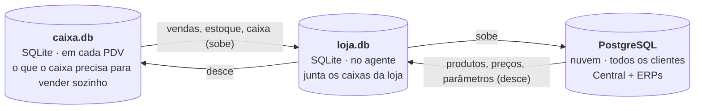
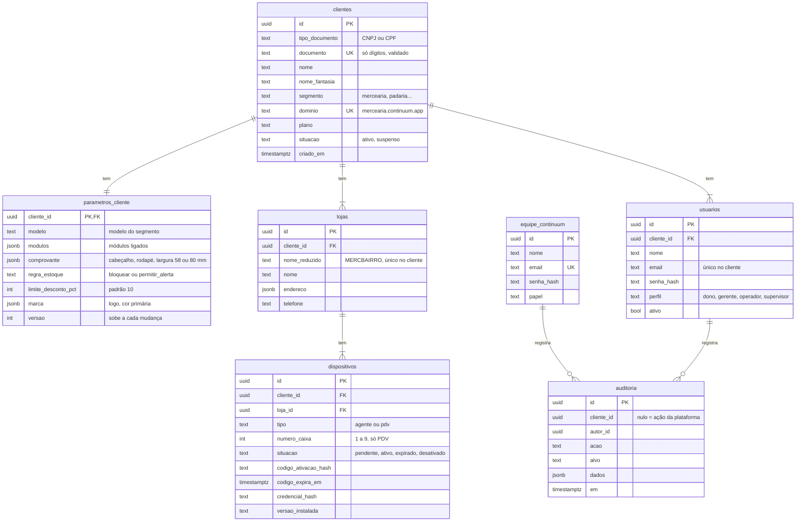
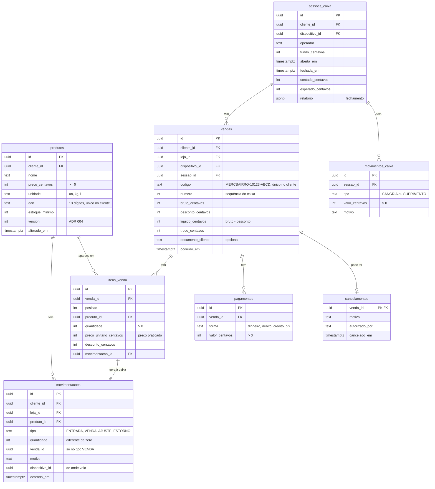
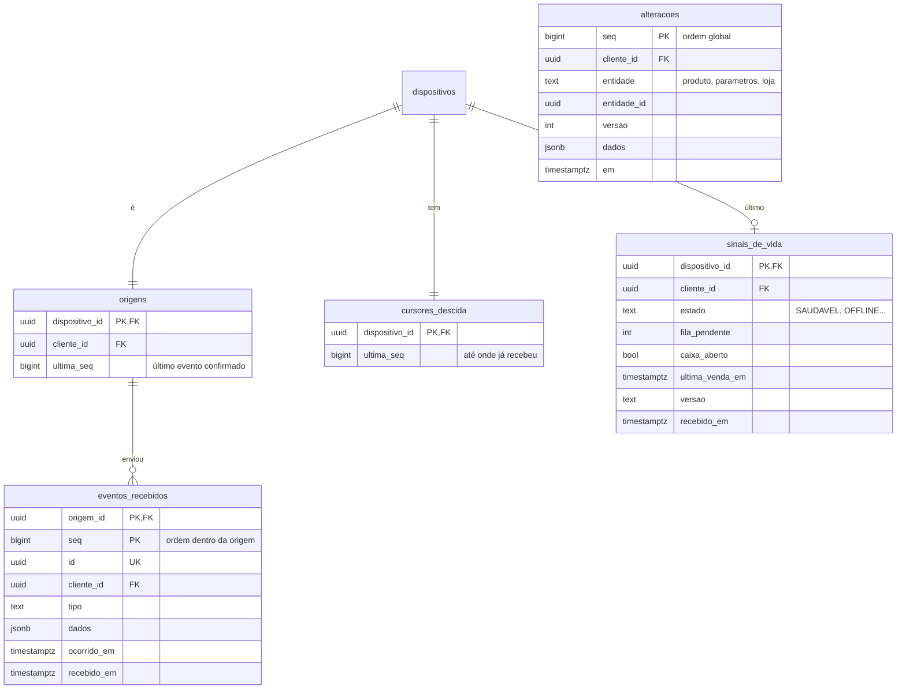

# Etapa 4 (parte 2) · Modelo do banco de dados

> Status: **✅ aprovada pelos sócios (decisões 1 a 7, 21/11/2026)**. Nenhuma tabela foi criada a partir deste documento ainda.
> Parte dos documentos aprovados: arquitetura (`01`), escalabilidade (`02`) e casos de uso e UML (`03`).

## Como ler este documento

- **Tabela:** uma "planilha" com colunas fixas; cada linha é um registro (um produto, uma venda).
- **Chave primária (PK):** a coluna que identifica cada linha sem repetição.
- **Chave estrangeira (FK):** uma coluna que aponta para a linha de outra tabela (o item aponta para a venda).
- **Restrição (CHECK, UNIQUE):** uma regra que o **próprio banco** impõe, mesmo se o programa errar.
- **Append-only:** tabela em que só se **acrescenta**; nada é editado nem apagado (como no OLD).
- Tabelas marcadas **P0** entram no MVP; **P1** vêm logo depois.

## 1. Três bancos, um mesmo modelo



**Por que três:** cada elo precisa funcionar sozinho quando o elo de cima cai (decisão 1 da
arquitetura). As tabelas têm **os mesmos nomes e colunas** nos três lugares; a diferença é o que cada
banco guarda:

| Banco | Guarda | Não guarda |
|---|---|---|
| `caixa.db` (PDV) | Catálogo e parâmetros (cópia), as **próprias** vendas e sessões, a fila do caixa | Vendas de outros caixas, outros clientes |
| `loja.db` (agente) | Catálogo e parâmetros (cópia), vendas e estoque de **todos os caixas da loja**, a fila da loja | Outras lojas, outros clientes |
| PostgreSQL (nuvem) | **Tudo**, de todos os clientes, isolado por cliente | — |

## 2. Convenções (valem para todas as tabelas)

| Convenção | Exemplo | Por quê |
|---|---|---|
| Identificadores **UUID v7** gerados na origem | `019a0b7c-...` | O caixa cria a venda sem perguntar à nuvem; o v7 já vem em ordem de criação (do OLD, ADR 002) |
| Dinheiro em **centavos inteiros** | `1890` = R$ 18,90 | Sem erro de arredondamento (do OLD) |
| Datas em **UTC** | `2026-11-21T14:36:00Z` | Lojas em fusos diferentes, um relógio só |
| **`cliente_id` em toda tabela da nuvem** | | Isolamento entre clientes (decisão 3 da Etapa 3) |
| Venda, item, movimentação e evento são **append-only** | | "Nada se perde": correção é um registro novo (estorno, ajuste) |
| Nomes em português, minúsculas, com `_` | `itens_venda` | Igual ao OLD; lê-se como a regra de negócio |
| SQL escrito à mão, sem ORM | | Igual ao OLD: o banco faz o que está escrito, sem "mágica" |

---

## 3. Nuvem (PostgreSQL)

### 3.1 Plataforma e cliente (o que o Central administra)



**Regras que o banco impõe:**
- `clientes.tipo_documento` só aceita `CNPJ` ou `CPF`, e `documento` precisa ter 14 ou 11 dígitos conforme o tipo.
- `lojas.nome_reduzido`: só `A–Z` e `0–9`, até 10 caracteres, **único dentro do cliente**.
- `dispositivos.numero_caixa`: de 1 a 9 e **único por loja**. É o dígito do caixa no código da venda
  (`MERCBAIRRO-10123`).
- Senhas, códigos de ativação e credenciais só como **hash**, nunca em texto (como o PIN no OLD).
- `auditoria` é append-only.

### 3.2 Operação (produtos, estoque, caixa e vendas)



**Regras que o banco impõe (herdadas do OLD e da Etapa 4):**
- O **saldo** de um produto não é uma coluna: é a **soma** de `movimentacoes.quantidade` (ADR 003).
- `ENTRADA` só positiva; `VENDA` só negativa e sempre com `venda_id`; os outros tipos, sem `venda_id`.
- `vendas.liquido_centavos = bruto_centavos − desconto_centavos`, verificado pelo banco.
- `vendas`, `itens_venda`, `pagamentos`, `movimentacoes` e `cancelamentos` são **append-only**.
- **Cancelar não altera a venda:** cria uma linha em `cancelamentos` e movimentações `ESTORNO`
  (o estoque volta). A venda original continua lá, como prova.
- Uma sessão fechada (`fechada_em` preenchido) não muda mais.

**Novidade em relação ao OLD:** a nuvem passa a receber **tudo** que o caixa sabe (desconto, líquido,
pagamentos, sessão, cancelamento). No OLD isso era impossível, porque a nuvem só aceitava 4 tipos de
evento e recalculava o total sem desconto. No sistema novo, os **contratos** (formato dos eventos) são
desenhados por nós desde o início.

### 3.3 Sincronização e monitoramento



| Tabela | Para que serve | Do OLD? |
|---|---|---|
| `origens` | Cada dispositivo é uma origem; guarda o último evento confirmado | Sim (`origens`), agora uma por dispositivo |
| `eventos_recebidos` | Tudo que chegou, exatamente como chegou: prova e auditoria. A chave `(origem, seq)` impede duplicar | Sim. Na fase de escala, **particionada por mês** |
| `alteracoes` | A "fila de descida": cada mudança de produto, preço ou parâmetro ganha um número em ordem | Novo |
| `cursores_descida` | Até onde cada dispositivo já recebeu; ele pede "tudo depois do nº N" | Novo |
| `sinais_de_vida` | Só o **último** heartbeat de cada dispositivo (uma linha, sobrescrita); alimenta o Monitor | Novo. O histórico de estados entra no P1, guardado por 30 dias |

### 3.4 Isolamento entre clientes (Row Level Security)

```sql
-- Exemplo do que será criado (ainda não foi): vale para toda tabela com cliente_id.
ALTER TABLE vendas ENABLE ROW LEVEL SECURITY;
CREATE POLICY so_do_cliente ON vendas
  USING (cliente_id = current_setting('app.cliente_id')::uuid);
```

**Em português:** a cada pedido, o servidor diz ao banco "este pedido é do cliente X". O banco passa a
**esconder** todas as linhas de outros clientes, mesmo que o programa esqueça um filtro. O Central usa
um acesso próprio, só de leitura, para enxergar o consolidado de todos.

### 3.5 Índices principais (o que deixa as consultas rápidas)

| Índice | Consulta que ele acelera |
|---|---|
| `movimentacoes (cliente_id, produto_id, quantidade)` | Saldo de um produto, lendo só o índice (do OLD: de 21 ms para 3,4 ms) |
| `vendas (cliente_id, loja_id, ocorrido_em)` | Relatório de vendas do dia por loja |
| `vendas (cliente_id, codigo)` único | Validar uma venda pelo código (UC19) |
| `alteracoes (cliente_id, seq)` | "Tudo depois do nº N" para a descida |
| `sinais_de_vida (cliente_id)` | Painel ao vivo de um cliente no Central |

---

## 4. Bancos locais (SQLite)

### 4.1 Agente (`loja.db`) e PDV (`caixa.db`)

As tabelas de operação (`produtos`, `movimentacoes`, `sessoes_caixa`, `vendas`, `itens_venda`,
`pagamentos`, `cancelamentos`, `movimentos_caixa`) são **iguais às da nuvem**, sem `cliente_id`
(cada banco local é de um cliente só). Além delas:

```mermaid
erDiagram
  config_local {
    text chave PK
    text valor "dispositivo, loja, credencial (hash), versão"
  }
  parametros {
    int versao PK
    text dados "cópia dos parâmetros do cliente"
  }
  sequencia_venda {
    int numero_caixa PK
    int ultimo_numero "só no PDV"
  }
  outbox {
    int seq PK
    text id UK
    text tipo
    text dados
    text ocorrido_em
    text sincronizado_em "vazio = ainda na fila"
  }
  outbox_falhas {
    int seq PK,FK
    int status
    text erro
  }
  recebidos_dos_caixas {
    text dispositivo_id PK
    int ultima_seq "só no agente: dedup por caixa"
  }
  cursor_descida {
    int unica PK
    int ultima_seq
  }
  estado_sync {
    int unica PK
    text estado "máquina de estados do OLD"
    text modo
    int falhas_seguidas
    int sucessos_seguidos
  }
```



| Tabela | PDV | Agente | Para que serve | Do OLD? |
|---|---|---|---|---|
| `outbox` | ✓ | ✓ | A fila: o PDV envia ao agente; o agente envia à nuvem | Sim, igual |
| `outbox_falhas` | ✓ | ✓ | Evento recusado de vez; bloqueia a fila para análise | Sim, igual |
| `estado_sync` | ✓ | ✓ | SAUDÁVEL, OFFLINE... de cada elo | Sim, igual |
| `sequencia_venda` | ✓ | — | O próximo número de venda do caixa; nunca repete | Novo (o número passa a ser por caixa) |
| `recebidos_dos_caixas` | — | ✓ | Até onde recebeu de cada caixa; impede duplicar | Novo (espelha `origens` da nuvem) |
| `cursor_descida` | ✓ | ✓ | Até onde recebeu produtos e preços | Novo |
| `parametros` | ✓ | ✓ | Cópia dos parâmetros do cliente (regra de estoque, comprovante) | Novo |
| `config_local` | ✓ | ✓ | Quem é este dispositivo e a credencial dele | Novo |

**Regra de ouro dos bancos locais (do OLD, ADR 001):** a venda e o seu evento na `outbox` são gravados
na **mesma transação**. Ou os dois existem, ou nenhum.

## 5. Como uma venda percorre os três bancos

| Momento | `caixa.db` | `loja.db` | Nuvem |
|---|---|---|---|
| Operador finaliza | `vendas` + `itens_venda` + `pagamentos` + `movimentacoes` + 1 evento na `outbox` | — | — |
| Caixa entrega ao agente | evento marcado como enviado | mesmas linhas + evento na `outbox` da loja; `recebidos_dos_caixas` avança | — |
| Agente envia à nuvem | — | evento marcado como enviado | `eventos_recebidos` + as mesmas linhas com `cliente_id`; `origens` avança |
| Monitor | — | — | `sinais_de_vida` mostra a fila zerada |

## 6. Mudanças na estrutura do banco (migrações)

- Cada mudança é um arquivo numerado (`0001_clientes.sql`, `0002_produtos.sql`...), aplicado em ordem,
  **uma única vez**, nos três bancos.
- Uma migração já aplicada **nunca é editada**; corrigir é criar a próxima.
- Cada banco guarda em qual migração está. Um PDV desatualizado se atualiza sozinho ao instalar a
  versão nova (com o caixa fechado).

## 7. Tamanho e guarda dos dados

| Dado | Tamanho aproximado | Guarda |
|---|---|---|
| Uma venda com 3 itens e o evento | ~2 KB | Para sempre na nuvem (exigência contábil: no mínimo 5 anos) |
| 1.000 caixas × 300 vendas/dia | ~600 MB/dia | Particionamento por mês na fase de escala |
| Eventos já sincronizados no PDV | — | Apagados do caixa após 90 dias **e** confirmados pela nuvem (o caixa não enche) |
| Sinais de vida | Uma linha por dispositivo | Só o último; histórico de 30 dias no P1 |
| CPF/CNPJ do cliente final | — | Só quando pedido na venda; mascarado nas telas; criptografado no banco no P1 (LGPD) |

## 8. Decisões para aprovar

| # | Decisão | Proposta |
|---|---|---|
| 1 | Clientes no mesmo banco | Um PostgreSQL com `cliente_id` em toda tabela + Row Level Security |
| 2 | Mesmo modelo nos três bancos | Tabelas de operação iguais na nuvem, no agente e no PDV |
| 3 | Cancelamento | Tabela própria + movimentações de estorno; a venda nunca é alterada |
| 4 | Descida de produtos e preços | Fila de alterações numerada + cursor por dispositivo |
| 5 | Monitor | Só o último sinal de vida por dispositivo; histórico no P1 |
| 6 | Acesso ao banco | SQL escrito à mão, sem ORM (como no OLD) |
| 7 | Limpeza do PDV | Eventos confirmados apagados do caixa após 90 dias |

## Glossário

| Termo | Explicação simples |
|---|---|
| **Banco de dados** | Onde o sistema guarda as informações, organizadas em tabelas |
| **PostgreSQL / SQLite** | Dois tipos de banco: o primeiro para a nuvem, o segundo um arquivo no computador |
| **Chave primária (PK)** | O "RG" de cada linha da tabela |
| **Chave estrangeira (FK)** | Uma coluna que aponta para a linha de outra tabela |
| **Índice** | Um "sumário" que deixa a busca rápida |
| **Append-only** | Só se acrescenta; nada se edita nem se apaga |
| **Row Level Security** | Regra no banco que esconde as linhas de outros clientes |
| **Migração** | Um passo numerado de mudança na estrutura do banco |
| **ORM** | Ferramenta que gera o SQL automaticamente; aqui escrevemos o SQL à mão |
| **Hash** | Uma "impressão digital" da senha: confere sem guardar a senha em si |
