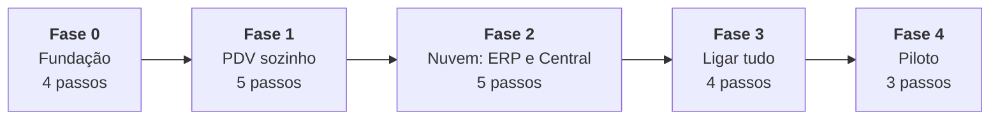

# Etapa 5 · Plano do MVP, passo a passo

> Status: **✅ aprovado pelos sócios (plano e decisões 1 a 4, 21/11/2026)**. É o roteiro da construção.
> Parte da modelagem aprovada: arquitetura (`01`), escalabilidade e front-end (`02`), casos de uso e UML
> (`03`) e banco de dados (`04`).

## Como vamos trabalhar em cada passo

Todo passo segue o mesmo ritual, para você acompanhar e aprender:

1. **Explico antes:** o que vou fazer, em quais arquivos e por quê, em linguagem simples.
2. **Você aprova** (ou pede ajuste).
3. **Faço** só aquele passo.
4. **Mostro o resultado:** o que mudou, o que você pode ver ou testar, e o que aprendemos.
5. **Você valida**, e só então vamos ao próximo.

Cada passo é pequeno de propósito: tem que caber numa conversa e terminar com **algo que dá para ver
funcionando** (uma tela, um teste passando, um comando que responde).

## O alvo do MVP

O **formato MEI** da arquitetura (um computador, PDV com agente embutido) ligado à nuvem, cobrindo os
casos de uso **P0** do documento `03`:

> A Equipe Continuum cadastra o cliente no Central; o dono configura a loja, cadastra os produtos e ativa
> o caixa no ERP; o operador abre o caixa, vende, imprime o comprovante e fecha o caixa no PDV; tudo
> sincroniza e aparece ao vivo no Central, mesmo depois de uma queda de internet.

O formato "loja com vários caixas e agente separado" vem logo depois do MVP: o código já nasce
preparado para ele (o agente é um pacote próprio desde o início).

## Visão geral

**Por que nesta ordem:** primeiro o que é comum a tudo (fundação); depois o **PDV sozinho**, porque é o
coração do Local First e já dá uma demonstração completa sem internet; depois a **nuvem**; por fim,
**ligamos** as duas pontas e provamos que nada se perde.

---

## Fase 0 · Fundação

| Passo | O que faço | O que você vai ver | Pronto quando |
|---|---|---|---|
| ✅ **0.1 Esqueleto do projeto** | Crio o monorepo na raiz: a pasta `pacotes/` com os 7 pacotes vazios (`dominio`, `contratos`, `sync`, `agente`, `pdv`, `nuvem`, `interface`), a configuração do TypeScript e dos testes, e os comandos `npm run testar` e `npm run verificar` | A árvore de pastas e um teste "olá" passando | `npm run testar` roda sem erro |
| 🟡 **0.2 Identidade visual (tokens)** (feito, aguardando aprovação do visual) | Pacote `interface`: as cores, medidas e tipografia do Continuum em tokens, nos temas claro e escuro, e uma página **vitrine** com os primeiros componentes (Botão, Cartão, Chip, Faixa de estado) | A vitrine no navegador, com a cara do Continuum, alternando claro e escuro | Você aprova o visual |
| 🟡 **0.3 Regras básicas** (feito, aguardando validação do lead) | Pacote `dominio`: dinheiro em centavos, validação de CPF, CNPJ e EAN (trazidos do OLD) e o **código da venda** (`MERCBAIRRO-10123-ABCD`), com testes | Os testes dizendo, em português, o que cada regra garante | Todos os testes passando |
| 🟡 **0.4 O "idioma" do sistema** (feito, aguardando validação do lead) | Pacote `contratos`: o formato de cada evento (produto, estoque, venda, caixa, sinal de vida), com validação escrita uma vez para tela e servidor | Exemplos de eventos válidos e inválidos nos testes | Testes passando |

## Fase 1 · PDV sozinho (sem internet, formato MEI)

| Passo | O que faço | O que você vai ver | Pronto quando |
|---|---|---|---|
| **1.1 Regras de venda e estoque** | Reconstruo em TypeScript a lógica de venda e estoque do OLD (venda imutável, saldo como soma, estoque nunca negativo), explicando cada arquivo do OLD antes | Testes cobrindo venda, falta de estoque, estorno | Testes passando |
| **1.2 A fila (outbox)** | Pacote `sync`: a fila em SQLite e as migrações do banco, reconstruídas do OLD | Teste provando "venda e evento juntos, ou nenhum" | Testes passando |
| **1.3 Banco e serviços do caixa** | `caixa.db` com as tabelas do documento `04`; serviços de abrir caixa, registrar venda, fechar caixa | Um roteiro de teste fazendo um dia de caixa completo | Testes passando |
| **1.4 Telas do PDV** | Telas em React (rodando primeiro no navegador): abrir caixa, venda, "Venda finalizada", fechamento | O PDV novo no navegador, com a cara do Continuum | Você consegue fazer uma venda e fechar o caixa |
| **1.5 PDV instalado e comprovante** | Empacoto no Electron; impressão do comprovante (58 e 80 mm) e reimpressão | O programa instalado abrindo e imprimindo (ou mostrando na tela, sem impressora) | Venda impressa com os dados do comércio |

## Fase 2 · Nuvem: ERP e Central

| Passo | O que faço | O que você vai ver | Pronto quando |
|---|---|---|---|
| **2.1 Servidor e banco da nuvem** | Pacote `nuvem`: servidor Node, PostgreSQL (o portátil do OLD em desenvolvimento), migrações e isolamento por cliente (Row Level Security) | Um teste provando que um cliente **não** enxerga dados de outro | Testes passando |
| **2.2 Login e perfis** | Login da Equipe Continuum (Central) e de dono e operador (ERP) | A tela de login funcionando | Cada perfil vê só o que pode |
| **2.3 Central: clientes** | Cadastrar cliente (CNPJ ou CPF, segmento, domínio) e parametrizar o ERP dele (UC01 e UC02) | O Central criando um cliente e o ERP dele aparecendo | Cliente de teste criado |
| **2.4 ERP: loja e produtos** | Configurar loja e comprovante, cadastrar produtos, entrada e ajuste de estoque, kardex (UC10 a UC15) | O ERP com a marca do cliente de teste | Produtos cadastrados com estoque |
| **2.5 ERP: caixa e relatórios** | Ativar caixa por código (UC17), relatório de vendas básico (UC18), validar venda pelo código (UC19) | Código de ativação gerado; relatório vazio pronto para receber vendas | Telas funcionando |

## Fase 3 · Ligar tudo

| Passo | O que faço | O que você vai ver | Pronto quando |
|---|---|---|---|
| **3.1 Ativação do PDV** | O PDV instalado recebe o código, ganha credencial e baixa loja, parâmetros e catálogo | Um caixa novo ativado e vendendo os produtos do ERP | Venda com produto cadastrado no ERP |
| **3.2 Subida (vendas → nuvem)** | O Sync Engine do OLD, reconstruído: a fila do caixa vai para a nuvem em ordem, sem duplicar | A venda feita no PDV aparecendo no relatório do ERP | Nuvem igual ao caixa, venda a venda |
| **3.3 Descida (preços → caixa)** | Fila de alterações e cursor: preço mudado no ERP chega ao PDV | Preço alterado no ERP aparecendo no caixa | Alteração recebida em segundos |
| **3.4 Monitor ao vivo** | Sinal de vida do PDV e painel do Central em tempo real (a essência do Continuum) | O Central mostrando o caixa vendendo, a fila e o estado | Queda de internet aparece no Central |

## Fase 4 · Piloto

| Passo | O que faço | O que você vai ver | Pronto quando |
|---|---|---|---|
| **4.1 Teste de queda** | O simulador de falhas (Kryptonita) do OLD aplicado ao sistema novo: derruba a internet, vende, volta, confere | O relatório "nada se perdeu", como no LAB | Teste automático aprovado |
| **4.2 Instalador e hospedagem** | Instalador do PDV e publicação da nuvem na opção A (camadas gratuitas) | Um endereço de verdade para o ERP e o Central | Acessível pela internet |
| **4.3 Primeiro cliente** | Cadastro e treinamento de um cliente piloto, com manual simples | Uma loja real usando o Continuum | Um dia completo de vendas sem perda |

---

## Decisões antes do Passo 0.1

| # | Decisão | Proposta |
|---|---|---|
| 1 | Versão do Node | **Node 26** (a do OLD). Em desenvolvimento usamos o Node 26 portátil que já está em `OLD/runtime`, sem instalar nada. Na máquina há o Node 24, que fica como está |
| 2 | Gerenciador de pacotes | **npm** com *workspaces* (já instalado, versão 11); sem ferramentas extras |
| 3 | Onde fica o código | Na raiz do projeto, ao lado de `docs/`, `site/` e `OLD/` |
| 4 | Versionamento (git) | Entra quando você decidir; recomendo **antes da Fase 1**, para termos histórico do código de verdade |

## Estimativa de ritmo

São **21 passos**. Com o ritual de explicar, aprovar, fazer e mostrar, cada passo leva tipicamente
**uma sessão de trabalho**. A Fase 0 e a Fase 1 juntas já entregam um **PDV novo funcionando sem
internet**, que serve para apresentações antes mesmo da nuvem existir.

## Glossário

| Termo | Explicação simples |
|---|---|
| **Monorepo** | Um repositório só com todas as partes do sistema |
| **Pacote** | Uma parte do sistema com responsabilidade própria (as regras, a fila, o PDV...) |
| **Workspaces** | Recurso do npm para vários pacotes conviverem no mesmo projeto |
| **Teste automático** | Um pequeno programa que confere se uma regra funciona; roda em segundos, sempre que quisermos |
| **Migração** | Um passo numerado de mudança na estrutura do banco |
| **Empacotar** | Transformar o código num programa instalável |
